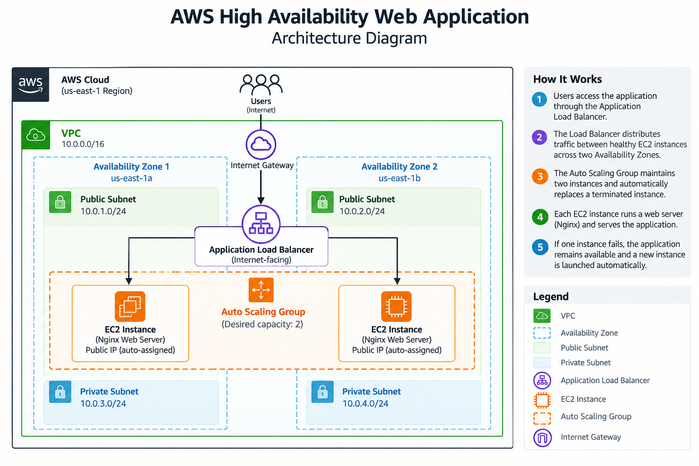

# AWS High Availability Web Application

### Building a reliable web application with AWS

## Project Overview

What happens when a company's website depends on a single server and that server suddenly stops working?

Customers may lose access to the website, and the business could experience downtime.

I built this hands-on AWS project to explore how cloud infrastructure can help prevent that problem.

The goal was to create a web application that runs across multiple servers and can automatically recover when one of them fails.

Using AWS networking, load balancing, and Auto Scaling, I built and tested a system designed to keep the application available even when an individual server goes down.

## The Business Problem

Imagine a small business running its website on one server.

If that server crashes, the website becomes unavailable until someone fixes or replaces it.

This creates three challenges:

- **Downtime:** Customers cannot access the website.
- **Reliability:** The business depends on a single server.
- **Manual recovery:** Someone must intervene to restore the service.

I wanted to build an infrastructure solution that reduces these risks through automation and redundancy.

## My Solution

I designed a web application environment using Amazon Web Services (AWS).

Instead of relying on one server, the application runs on two EC2 instances located in different AWS Availability Zones.

An Application Load Balancer distributes incoming traffic between the healthy instances.

An Auto Scaling Group maintains the required number of servers and automatically launches a replacement if one is terminated.

This means the application does not depend on a single EC2 instance to remain available.

## AWS Services Used

| AWS Service                | What It Does in This Project                        |
| -------------------------- | --------------------------------------------------- |
| Amazon VPC                 | Creates an isolated network for the application     |
| Public and Private Subnets | Organize the network into separate areas            |
| Internet Gateway           | Provides internet connectivity for public resources |
| Amazon EC2                 | Hosts the web application                           |
| Application Load Balancer  | Distributes website traffic between healthy servers |
| EC2 Auto Scaling           | Automatically replaces terminated servers           |
| Launch Template            | Defines how new servers should be created           |
| Security Groups            | Control which network connections are allowed       |
| Amazon Linux 2023          | Operating system used by the servers                |
| Nginx                      | Web server used to display the application          |

## Architecture

The final working application used:

- One custom VPC.
- Two public subnets across two Availability Zones.
- Two EC2 instances running Nginx.
- One internet-facing Application Load Balancer.
- One Auto Scaling Group maintaining two EC2 instances.
- One Launch Template to automate instance configuration.
- Security Groups to control application traffic.

The VPC also included private subnets for network segmentation and future expansion. The final web servers ran in public subnets.

**Traffic flow:**

User → Application Load Balancer → Healthy EC2 Instance → Web Application

If one EC2 instance becomes unavailable, the Load Balancer can continue directing traffic to the remaining healthy instance while Auto Scaling creates a replacement.

## Implementation

### 1. Building the Network

I created a custom VPC and configured public and private subnets across two Availability Zones.

I also configured an Internet Gateway, route tables, and Security Groups to control network connectivity.

This helped me understand how AWS resources communicate and how network configurations affect application availability.

### 2. Deploying the Web Application

I launched an EC2 instance using Amazon Linux 2023 and installed Nginx to host a simple webpage.

I then connected the application to an Application Load Balancer and verified that the website could be accessed through the Load Balancer's DNS address.

### 3. Automating Server Deployment

I created a Launch Template containing the configuration needed to launch new EC2 instances.

Using a User Data script, each new server could automatically install Nginx, start the service, and create the webpage.

This removed the need to manually configure every new instance.

### 4. Configuring Auto Scaling

I created an Auto Scaling Group with a desired capacity of two instances.

The instances were distributed across two Availability Zones and registered with the Load Balancer's Target Group.

I verified that both instances passed the health checks and could serve the application.

### 5. Testing Automatic Recovery

To simulate a real-world server failure, I manually terminated one EC2 instance managed by the Auto Scaling Group.

AWS detected that the group had fewer instances than required and automatically launched a replacement.

The remaining healthy instance continued serving the application during the recovery process.

After the replacement completed its initialization and health checks, the Target Group returned to two healthy instances.

**Result: The application remained accessible during the test, and the infrastructure automatically recovered its required capacity.**

## Challenges and Troubleshooting

One of the most valuable parts of this project was troubleshooting unexpected behavior.

**Challenge 1: EC2 instances failed their health checks**

During the initial setup, newly launched EC2 instances were marked as unhealthy.

I investigated the network configuration, instance logs, and application installation process to understand what was happening.

**Challenge 2: Instances could not download the web server software**

I discovered that some newly launched instances did not have the internet connectivity required to download Nginx.

After reviewing the subnet settings, I enabled automatic public IPv4 address assignment for the public subnets.

I then tested the deployment again and confirmed that the new instance received a public IP address.

**Challenge 3: Understanding instance initialization**

A newly created instance initially appeared unhealthy even though Nginx had installed successfully.

By checking the system logs and allowing the health checks to complete, I confirmed that the application was functioning correctly.

These challenges taught me the importance of troubleshooting systematically rather than assuming that every unhealthy instance has the same underlying problem.

## Project Results

By the end of the project, I successfully:

- Deployed a working web application on AWS.
- Configured load balancing across two EC2 instances.
- Distributed instances across two Availability Zones.
- Automated server creation using a Launch Template and User Data.
- Verified that both instances passed application health checks.
- Tested automatic EC2 replacement after a simulated server failure.
- Confirmed that the application remained accessible during recovery.
- Cleaned up the AWS resources after testing to avoid unnecessary costs.

## What I Learned

This project helped me connect AWS concepts with practical cloud engineering tasks.

I gained hands-on experience with:

- Designing AWS network infrastructure.
- Understanding public and private subnets.
- Configuring security and network access.
- Deploying Linux-based web servers.
- Implementing load balancing.
- Automating infrastructure behavior.
- Investigating application health check failures.
- Testing recovery from server failures.
- Managing cloud resources with cost awareness.

Most importantly, I learned that building cloud infrastructure is not just about creating resources. It is about understanding how those resources work together, identifying failures, and making systems more reliable.

## Future Improvements

Possible next steps include:

- Adding CloudWatch monitoring and alarms.
- Configuring CPU-based dynamic scaling.
- Moving application servers into private subnets with appropriate outbound connectivity.
- Using Terraform to deploy the infrastructure as code.
- Adding HTTPS with AWS Certificate Manager.
- Exploring a highly available database layer.

## Project Status

**Completed — Hands-on implementation, availability testing, and resource cleanup.**

This project is part of my hands-on learning journey as I transition into a career in AWS Cloud Engineering.

The AWS resources were removed after testing to avoid unnecessary charges.
